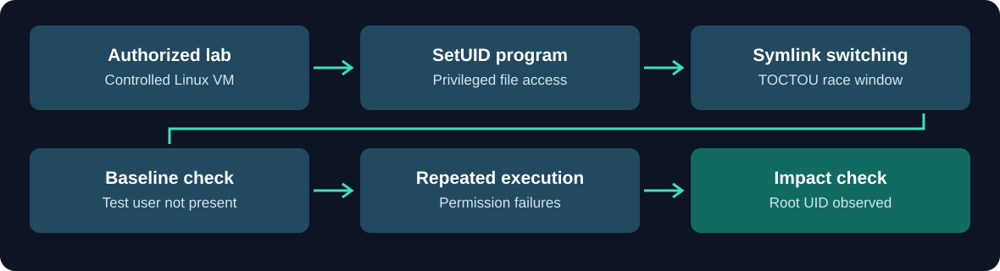
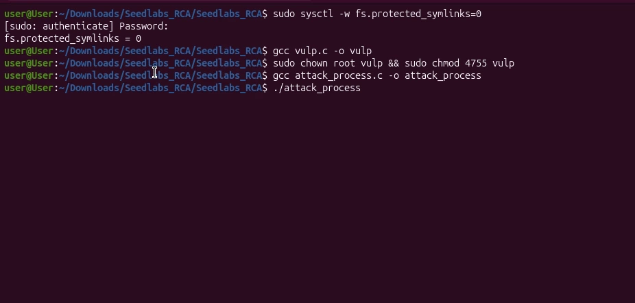
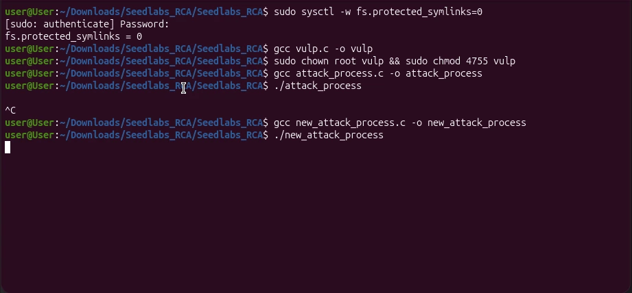
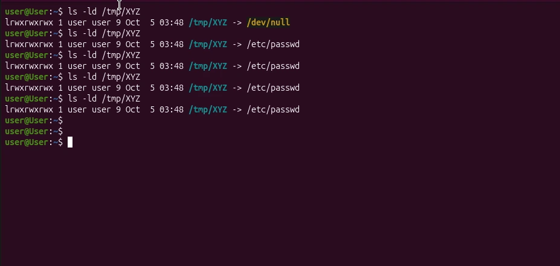
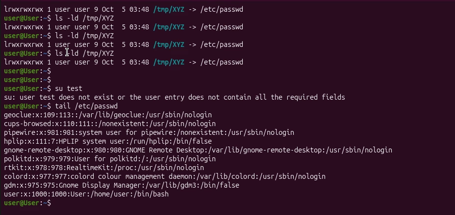
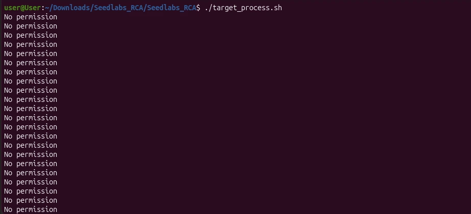
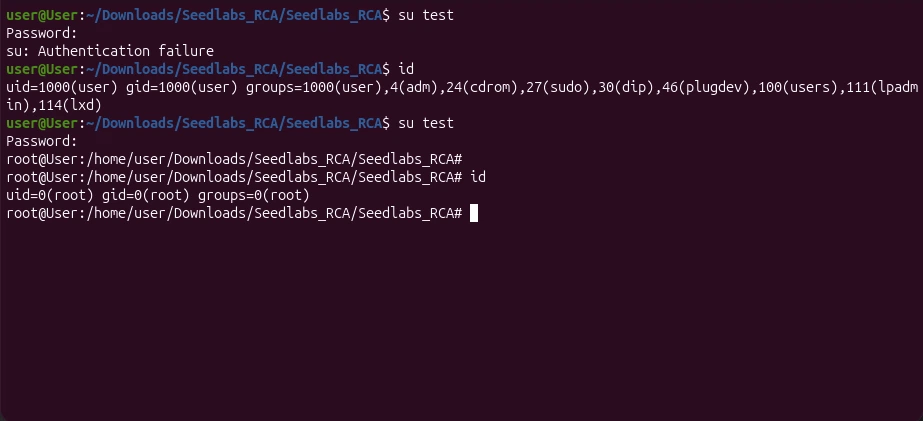

# CYSE 211 — Lab 5: TOCTOU Race Condition & SetUID Security

   

CYSE 211 Lab 5 documents an **authorized, isolated Linux lab** exploring a time-of-check-to-time-of-use (**TOCTOU**) race condition in a privileged SetUID program. The exercise examines how symbolic-link changes between a permission check and file access can affect a protected system file and how the resulting impact was verified.

*The repository documents a completed classroom exercise with screenshots; it is not an exploitation toolkit.*

**Original report:** [View the five-page Lab 5 PDF](docs/CYSE211_Lab5_Report.pdf)

## At a Glance

| Item | Details |
|---|---|
| Security focus | TOCTOU race condition, symbolic links, and privilege boundaries |
| Environment | Linux SEEDLabs classroom environment |
| Components examined | A SetUID C program, a changing symbolic link, and repeated test executions |
| Outcome documented | The final screenshot shows `id` reporting `uid=0(root)` |
| Evidence | 6 screenshots shown inline; complete 5-page lab PDF |

## Assessment Workflow

## Evidence Screenshots

All six supplied screenshots appear directly below in the same sequence as the lab report.

### Step 1 — Lab Environment and SetUID Setup

The lab screenshot documents the intentionally vulnerable configuration, compilation of the example program, and assignment of SetUID ownership/permissions to the classroom target. These settings are part of the controlled experiment, not recommended production configuration.

### Step 2 — Initial Attempt and Revised Process

The initial attack process was interrupted after an apparent stall. A revised process was then compiled and launched. The image documents the transition to the revised test, not independent proof of its effectiveness.

### Step 3 — Symbolic-Link State Changes

Successive terminal queries show the laboratory path `/tmp/XYZ` pointing at different destinations, including `/dev/null` and `/etc/passwd`. This illustrates the state change central to the TOCTOU demonstration.

### Step 4 — Before: Test Account Not Available

Before the final demonstration, an attempt to switch to the `test` account failed. The captured tail of the account file shows ordinary account entries, establishing the baseline visible in the report.

### Step 5 — Repeated Target Execution

The test script repeatedly prints `No permission`. These failures document the behavior observed during repeated attempts; on their own they do not establish successful privilege escalation.

### Step 6 — After: Root Identity Observed

The final screenshot shows an initial authentication failure followed by a successful switch and an `id` output reporting `uid=0(root)`, `gid=0(root)`. This is the central outcome documented by the lab report.

## Findings and Evidence

| Finding | Evidence | Security significance |
|---|---|---|
| Deliberately weakened symlink protections | Step 1 | A system defense was disabled for the isolated experiment |
| Privileged SetUID execution context | Step 1 | Errors in privileged file operations can cross a permission boundary |
| A mutable symbolic link | Steps 2–3 | File identity can change between validation and use |
| Initially unsuccessful account check | Step 4 | Provides a comparison point for the later outcome |
| Repeated permission errors | Step 5 | Repeated attempts do not imply guaranteed exploit success |
| Root identity reported after the race-condition test | Step 6 | The captured result demonstrates the potential impact of privilege-boundary failure |

## What This Project Demonstrates

- Recognizing the difference between checking a file path and safely using that same resource.
- Understanding why TOCTOU vulnerabilities can exist in privileged software.
- Observing how symbolic links affect filesystem operations under concurrent changes.
- Establishing a before-and-after evidence trail rather than relying on a single output.
- Assessing how SetUID privileges amplify the impact of unsafe filesystem access.
- Identifying the need to retain kernel symlink protections and design file operations to avoid check/use races.

*Source: CYSE 211 Lab 5 report and its six screenshots. No exploit source files, executable payloads, or password material are included.*
